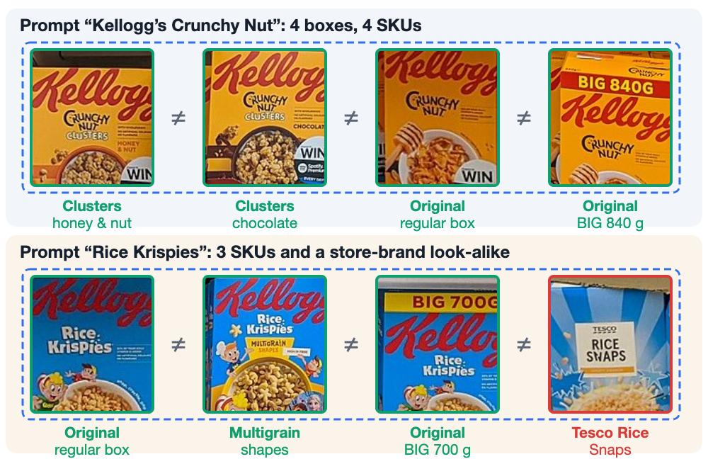
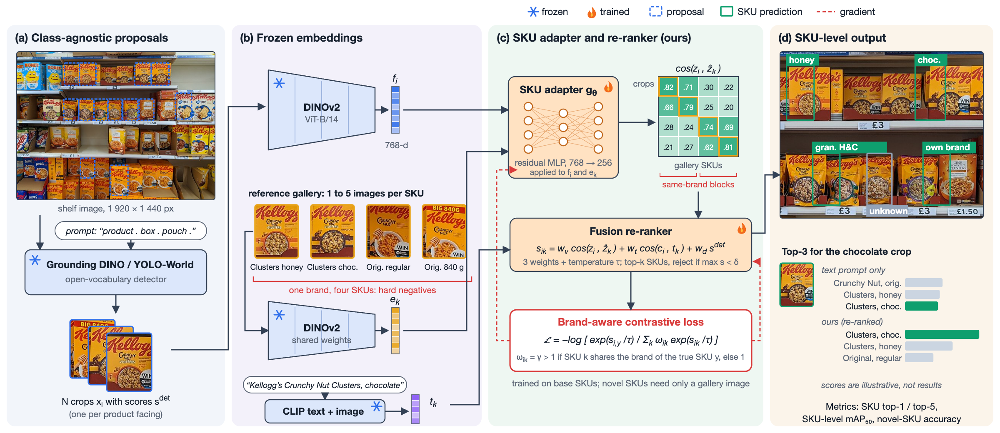

# SKU-Sense

**Same Brand, Different SKU: Open-Vocabulary Detection of Near-Identical Products on Retail Shelves**

BITS F459 Computer Vision mini project (BITS Pilani, Dubai Campus, 2026-27).
Kirtika, Wundavalli Venkata Aneesh, Vaishnavi, Devadutt Balakrishnan, Rohit Vinod Nair.



Open-vocabulary detectors such as Grounding DINO, YOLO-World and OWLv2 find products from a text
prompt, but a brand-level prompt fires on every variant of that brand. This project measures how much
accuracy these detectors lose between the product category and the exact stock-keeping unit (SKU) on
real shelf images, and compares three fixes on the same proposals:

1. SKU-name text prompts,
2. visual-exemplar prompts (OWLv2 image queries, MQ-Det, DE-ViT),
3. a 0.7 M-parameter adapter and fusion re-ranker on frozen DINOv2 features, trained with a
   brand-aware contrastive loss (ours).



## Status

| Term | Deliverable | State |
|---|---|---|
| I | Problem formulation and literature review (CVPR-format manuscript) | done: [`paper/main.pdf`](paper/main.pdf) |
| II | Implementation, experiments and demo | planned, see the schedule in the paper |

## Repository layout

```
paper/     manuscript source (CVPR author kit), references, built PDF
fig/       figure generators (SVG drawn in Python, rendered to vector PDF with Chromium)
img_raw/   shelf photographs used in the figures
tools/     originality check against the course sample manuscript
```

## Build the paper

```
cd paper
pdflatex main && bibtex main && pdflatex main && pdflatex main
```

## Regenerate the figures

```
pip install pillow playwright && playwright install chromium
cd fig
python make_fig.py && python render_fig.py arch && cp fig_arch.pdf ../paper/
python make_teaser.py && python render_fig.py teaser && cp fig_teaser.pdf ../paper/
```

## Data and models (Term II)

- Grocery Products with the OS2D per-instance re-annotation (main benchmark), RP2K (training pairs),
  SKU-110K (proposal recall only).
- Grounding DINO (Apache-2.0), DINOv2 (Apache-2.0), OWLv2 via Hugging Face Transformers (Apache-2.0),
  CLIP (MIT), YOLO-World (GPL-3.0).

## Credits

Shelf photographs: "Tesco Supermarket (Cereal)" and "Tesco Supermarket (Cereal) (2)" by Vauxford,
Wikimedia Commons, CC BY-SA 4.0.
